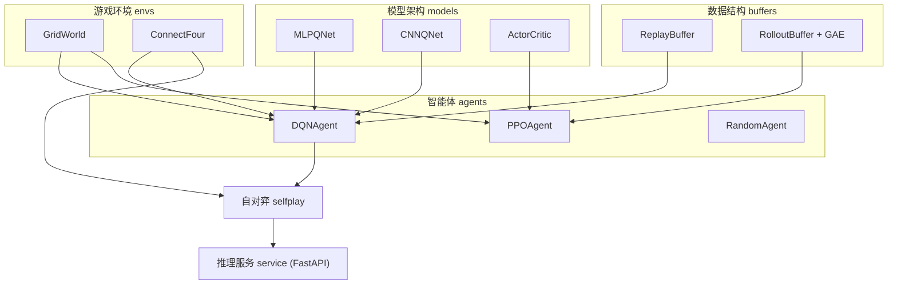

# 🎮 Game AI System

> 面向 **游戏 AI 算法** 方向的深度学习 / 强化学习项目:自研游戏环境、可插拔的模型架构、
> 竞技对抗自对弈训练,以及一个 **稳定的游戏 AI 推理服务**。


---

## ✨ 特性

- 🕹️ **自研游戏环境**(类 Gym 接口,零外部游戏依赖)
  - `GridWorld`:带障碍 / 陷阱的单智能体导航
  - `ConnectFour`:双人零和竞技对抗(四子棋)
- 🧠 **多种 RL 算法**:DQN(目标网络 + 合法动作掩码 + ε 衰减 + 零和自举)、PPO(GAE + Clipping)
- 🌳 **MCTS / AlphaZero**:策略-价值网络 + P-UCT 树搜索 + 目录噪声自对弈
- 🏗️ **可插拔模型架构**:MLP / CNN / AlphaZero 价值-策略网络,按观测形状自动选择
- ⚔️ **自对弈训练**:对手快照 + 视角统一编码,实现竞技类游戏的自我博弈
- 📈 **训练可视化**:`MetricsLogger` 输出 CSV,`plot_curves.py` 优先出 PNG、缺失 matplotlib 自动回退 ASCII 折线
- 🎨 **对局前端**:服务内置可点击的四子棋网页,浏览器里直接对战 AI
- 🚀 **稳定推理服务**:FastAPI 提供 `/health` 与 `/v1/move`,无权重时优雅降级为随机策略
- ⚡ **GPU 加速**:自动检测 CUDA / MPS,可在 RTX 显卡上训练
- 🧪 **完整测试**:环境规则、智能体、服务接口均有 pytest 覆盖

## 🏛️ 架构总览



## 📂 目录结构

```
game-ai/
├── envs/            # 游戏环境:GridWorld / ConnectFour
├── models/          # 网络架构:MLP / CNN / ActorCritic / AlphaZeroNet
├── buffers/         # ReplayBuffer / RolloutBuffer(GAE)
├── agents/          # DQN / PPO / Random
├── search/          # MCTS:ConnectFourState + AlphaZeroMCTS(P-UCT)
├── selfplay/        # 竞技对抗自对弈:DQN 联赛 + AlphaZero 训练器
├── service/         # FastAPI 推理服务 + 内置对局前端(web.py)
├── utils/           # 随机种子 / 设备解析(GPU 友好)/ 指标记录
├── scripts/         # 训练、对战、绘图、服务启动脚本
├── tests/           # pytest 测试
├── pyproject.toml
└── requirements.txt
```

## 🚀 快速开始

```bash
# 1. 安装依赖
pip install -r requirements.txt

# 2. 训练 GridWorld 上的 DQN(自动使用 GPU)
python scripts/train_grid_dqn.py --episodes 400

# 3. 训练 GridWorld 上的 PPO
python scripts/train_grid_ppo.py --updates 40

# 4. 四子棋自对弈训练
python scripts/train_connect4_selfplay.py --episodes 2000

# 4b. AlphaZero 自对弈(MCTS + 策略价值网络)
python scripts/train_alphazero.py --iterations 30 --games-per-iter 4 --sims 64

# 4c. 训练曲线可视化(PNG,或无 matplotlib 时输出 ASCII)
python scripts/plot_curves.py runs/alphazero.csv

# 5. 命令行与 AI 对战
python scripts/play.py --model checkpoints/connect4_dqn.pt

# 6. 启动推理服务(浏览器打开 http://localhost:8000 即可对战)
python scripts/serve.py --port 8000 --model checkpoints/connect4_dqn.pt
```

## 🔌 推理服务 API

启动后访问 `http://localhost:8000/docs` 查看交互式文档。

| 方法 | 路径 | 说明 |
|---|---|---|
| GET | `/health` | 健康检查,返回版本与模型加载状态 |
| POST | `/v1/move` | 给定棋盘与行棋方,返回 AI 决策列 |

**请求示例**

```bash
curl -X POST http://localhost:8000/v1/move \
  -H "Content-Type: application/json" \
  -d '{"board": [[0,0,0,0,0,0,0],[0,0,0,0,0,0,0],[0,0,0,0,0,0,0],[0,0,0,0,0,0,0],[0,0,0,0,0,0,0],[1,0,0,0,0,0,2]], "player": 1}'
```

**响应示例**

```json
{ "action": 3, "player": 1, "model": "connect4_dqn.pt", "confidence": 0.42 }
```

## 🧪 运行测试

```bash
pip install pytest httpx
pytest
```

## 🎯 设计亮点

- **视角统一编码**:四子棋观测以"当前行棋方"为通道 0,使同一网络服务双方,天然适配自对弈。
- **零和 Q 学习**:DQN 在双人对抗下对 Bellman 自举项取负(`zero_sum=True`),逼近极小极大行为。
- **AlphaZero 搜索**:P-UCT 选择 + 网络策略先验 + 根节点 Dirichlet 噪声,逐层取负反传终局价值。
- **优雅降级**:推理服务在缺失权重时自动回退随机策略,保证线上可用性。
- **设备抽象**:`utils.resolve_device` 自动选择 CUDA / MPS / CPU,并支持多卡编号。
- **零依赖可视化**:训练指标以 CSV 落盘,可选 matplotlib 出图,否则终端 ASCII 折线。

## 🗺️ Roadmap

- [x] 引入 MCTS + 价值网络(AlphaZero 风格)
- [x] 训练曲线可视化(CSV + PNG / ASCII)
- [x] 对局前端(浏览器点击对战)
- [ ] 更大对手池与 Elo 分级(AlphaStar 风格 League)
- [ ] 并行自对弈与经验回放池,提升数据利用率
- [ ] 模型导出 ONNX,推理服务支持批处理

## 📄 License

本项目基于 [MIT License](LICENSE) 开源。
